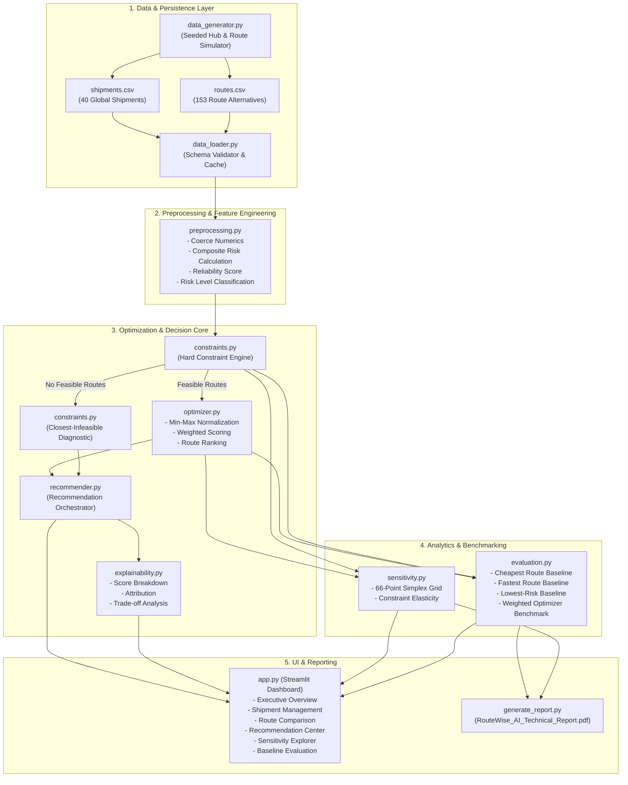

# RouteWise AI — System Architecture & Engineering Specification

This document provides a comprehensive technical reference for the architecture, mathematical formulations, software design patterns, and data contracts of the **RouteWise AI** multi-objective route optimization platform.

---

## 1. Architectural Principles & Goals

RouteWise AI is engineered around five fundamental software and mathematical tenets:

1. **Strict Invariant Guardrails:** Hard constraints (budget, transit days, delay probability) are non-negotiable filters. No recommendation may ever violate a customer's hard constraints.
2. **Mathematical Robustness:** Operations on empirical data must be resilient against edge cases (e.g., zero variance in metrics, empty candidate sets, singular boundary inputs).
3. **Transparent Explainability:** Every recommendation must be accompanied by mathematical attribution, score decomposition, and plain-English trade-off explanations grounded in actual computed values.
4. **Modularity & Decoupling:** Clean separation between data generation, feature engineering, constraint filtering, optimization scoring, evaluation benchmarking, and user interface.
5. **Reproducibility & Auditability:** Deterministic random seeding ensures identical dataset generation and reproducible benchmarks across different execution environments.

---

## 2. High-Level System Architecture

The following diagram illustrates the flow of data through the RouteWise AI pipeline:



---

## 3. Component Deep Dive

### 3.1 Data Generation & Validation Layer (`src/data_generator.py`, `src/data_loader.py`)

- **Global Logistics Topography:** Simulates 15 primary global shipping hubs spanning 7 macro-regions:
  - *East Asia:* Shanghai, Busan, Tokyo
  - *Southeast Asia:* Singapore
  - *Europe:* Rotterdam, Hamburg
  - *Middle East:* Dubai, Jeddah
  - *North America:* Los Angeles, New York
  - *South Asia:* Mumbai, Colombo
  - *Oceania, South America, Africa:* Sydney, Santos, Cape Town
- **Corridor Distance Categorization:** Origin-destination pairs are classified into `short`, `medium`, or `long` corridors to establish realistic baseline costs ($800–$15,000) and transit durations (3–45 days).
- **Route Archetypes:** For each shipment, 3 to 5 distinct routes are generated covering realistic archetypes:
  1. *Cheap but Slow:* Direct ocean freight, minimal handling, extended sailing time.
  2. *Fast but Expensive:* Air/express intermodal, premium slot fees, accelerated transit.
  3. *Balanced Compromise:* Standard maritime liner with efficient intermediate transshipment hubs.
  4. *Risky but Economical:* Feeder route through high-congestion regional ports.
  5. *Reliable Premium:* Carrier with guaranteed berth priority and low historical disruption.
- **Data Integrity Contract:** `_validate_data()` enforces non-null fields, strict presence of all mandatory schema columns, non-negative values for all physical metrics, and ensures every shipment has at least one associated route alternative.

---

### 3.2 Preprocessing & Risk Synthesis (`src/preprocessing.py`)

Real-world risk cannot be modeled as a single scalar. RouteWise AI calculates a composite risk index $R \in [0, 1]$:

$$R = 0.50 \cdot P(\text{delay}) + 0.30 \cdot R(\text{congestion}) + 0.20 \cdot R(\text{geopolitical})$$

- **Reliability Score:** Defined as the complementary metric:
  $$\text{Reliability} = 1.0 - R$$
- **Risk Stratification:**
  - $R \le 0.15$: **Low Risk** (Emerald)
  - $0.15 < R \le 0.30$: **Medium Risk** (Amber)
  - $0.30 < R \le 0.45$: **High Risk** (Rose)
  - $R > 0.45$: **Critical Risk** (Crimson)

---

### 3.3 Constraint Engine Subsystem (`src/constraints.py`)

The constraint engine executes before optimization scoring. Given a shipment with constraint thresholds $(B_{\max}, T_{\max}, D_{\max})$:

#### Hard Feasibility Verification:
$$\text{is\_feasible}(r) \iff (\text{Cost}(r) \le B_{\max}) \land (\text{Transit}(r) \le T_{\max}) \land (\text{Delay}(r) \le D_{\max})$$

#### Margin Quantification & Soft Slack Advisories:
For every constraint $k$, the margin $M_k = \text{Limit}_k - \text{Actual}_k$ is computed. Positive margins indicate slack capacity; negative margins pinpoint exact violation amounts. If a feasible route operates with $M_k / \text{Limit}_k < 0.05$ (less than 5% remaining slack), a soft capacity advisory warning is flagged to alert dispatchers of tight buffer margins.

#### Infeasible Route Recovery & Actionable Concessions (`find_closest_infeasible`, `compute_required_relaxations`):
When all candidate routes violate at least one constraint, the engine evaluates normalized violation distance:

$$D_{\text{viol}}(r) = \max\left(0, \frac{\text{Cost}(r) - B_{\max}}{B_{\max}}\right) + \max\left(0, \frac{\text{Transit}(r) - T_{\max}}{T_{\max}}\right) + \max\left(0, \frac{\text{Delay}(r) - D_{\max}}{D_{\max}}\right)$$

The candidate minimizing $D_{\text{viol}}$ is selected as the **closest infeasible route**. The `compute_required_relaxations()` algorithm then computes the exact deficit ($\text{Actual} - \text{Limit}$) and percentage increase necessary across each violated constraint to make this closest alternative feasible.

---

### 3.4 Multi-Objective Optimization Engine (`src/optimizer.py`)

#### Step 1: Min-Max Normalization with Singularity Protection
For each objective metric $M \in \{\text{Cost}, \text{Transit Time}, \text{Composite Risk}\}$ across candidate set $\mathcal{R}_{\text{feas}}$:

$$M_{\text{norm}}(r) = \begin{cases} 
\frac{M(r) - \min_{r' \in \mathcal{R}_{\text{feas}}} M(r')}{\max_{r' \in \mathcal{R}_{\text{feas}}} M(r') - \min_{r' \in \mathcal{R}_{\text{feas}}} M(r')} & \text{if } \max M(r') > \min M(r') \\
0.0 & \text{if } \max M(r') = \min M(r')
\end{cases}$$

#### Step 2: Convex Combination Scoring & Priority Presets
Given valid normalized weights $(w_{\text{cost}}, w_{\text{time}}, w_{\text{risk}})$ where $\sum w_i = 1$ and $w_i \ge 0$:

$$\text{Score}(r) = w_{\text{cost}} \cdot C_{\text{norm}}(r) + w_{\text{time}} \cdot T_{\text{norm}}(r) + w_{\text{risk}} \cdot R_{\text{norm}}(r)$$

Pre-calibrated priority profiles map shipment urgency to standard weights:
- *Critical:* $w = (0.15, 0.55, 0.30)$
- *Expedited:* $w = (0.20, 0.60, 0.20)$
- *Balanced:* $w = (0.40, 0.35, 0.25)$
- *Economy:* $w = (0.65, 0.20, 0.15)$

#### Step 3: Pareto Frontier Computation & Efficiency Verification
The engine computes non-domination status for each candidate route. Route $A$ dominates $B$ if $A$ is no worse than $B$ on all three metrics and strictly better on at least one.
- **Convex Scalarization Guarantee:** By multi-objective optimization theory, minimizing any strictly positive linear weighted sum over a finite set always yields a point on the Pareto frontier. RouteWise AI programmatically verifies and flags this invariant on recommended routes.

---

### 3.5 Recommender & Explainability Subsystem (`src/recommender.py`, `src/explainability.py`)

- **Dynamic Value Grounding:** Explanations do not use generic template text or placeholder values. Instead, they dynamically inject:
  - Exact raw and normalized metrics for the recommended route.
  - Mathematical percentage contributions of each objective ($w_i \cdot M_{\text{norm}} / \text{Score}$).
  - Comparative analysis with the runner-up route (identifying why the runner-up scored lower).
  - Explicit trade-offs against the cheapest, fastest, and lowest-risk alternatives.
- **No-Feasible Diagnostic Reports:** If all routes fail, the recommender itemizes each violation and outputs specific concession targets.

---

### 3.6 Sensitivity Analysis Subsystem (`src/sensitivity.py`)

1. **Weight Simplex Grid Search:**
   Discretizes the 3-dimensional weight space using a simplex step size $\Delta = 0.10$:
   $$\mathcal{W} = \left\{(w_c, w_t, w_r) \;\middle|\; w_c = i\Delta, \; w_t = j\Delta, \; w_r = 1 - w_c - w_t, \; w_r \ge 0\right\}$$
   Generating exactly $\frac{(N+1)(N+2)}{2} = 66$ distinct test configurations for $N=10$.
2. **Stability Quantification:**
   Computes route selection frequencies:
   $$\text{Stability}(r^*) = \frac{\sum_{w \in \mathcal{W}} \mathbb{I}(\text{recommendation}(w) = r^*)}{|\mathcal{W}|}$$
   High stability indicates a route that dominates across wide priority ranges.
3. **Constraint Elasticity:**
   Sweeps constraint multipliers from $0.5\times$ to $2.0\times$ across Budget, Transit, and Delay to identify critical capacity thresholds and feasibility drop-off points.

---

### 3.7 Baseline Evaluation Subsystem (`src/evaluation.py`)

Benchmarks the multi-objective optimizer against three industry heuristics across the entire shipment portfolio:
1. **Cheapest Route:** $\arg\min_{r \in \mathcal{R}_{\text{feas}}} \text{Cost}(r)$
2. **Fastest Route:** $\arg\min_{r \in \mathcal{R}_{\text{feas}}} \text{Transit}(r)$
3. **Lowest-Risk Route:** $\arg\min_{r \in \mathcal{R}_{\text{feas}}} \text{Delay Probability}(r)$
4. **Weighted Optimization:** $\arg\min_{r \in \mathcal{R}_{\text{feas}}} \text{Score}(r)$

The module measures network-wide averages for cost, transit time, delay rate, constraint satisfaction percentage, and average optimization score.

---

## 4. Empirical Benchmark Results

Evaluated across the full 40-shipment network (153 alternative routes):

```
+-----------------------+---------------------+-------------------+------------------+---------------+----------------+
| Strategy              | Shipments Evaluated | Constraints Sat.% | Avg Cost ($)     | Avg Transit   | Avg Delay Prob | Avg Opt Score  |
+-----------------------+---------------------+-------------------+------------------+---------------+----------------+
| Weighted Optimization | 40                  | 85.0%             | $9,312.09        | 23.9 days     | 16.5%          | 0.1808 (BEST)  |
| Cheapest Route        | 40                  | 85.0%             | $8,380.06 (MIN)  | 26.4 days     | 19.1%          | 0.2283         |
| Fastest Route         | 40                  | 85.0%             | $9,796.56        | 22.9 days(MIN)| 16.6%          | 0.2186         |
| Lowest-Risk Route     | 40                  | 85.0%             | $9,696.31        | 24.3 days     | 14.8% (MIN)    | 0.2374         |
+-----------------------+---------------------+-------------------+------------------+---------------+----------------+
```

### Analysis:
- Each single-objective heuristic successfully minimizes its target column, confirming baseline implementation correctness.
- **Weighted Optimization achieves the lowest Average Optimization Score (0.1808)**, demonstrating that it successfully minimizes overall regret across conflicting dimensions.

---

## 5. Algorithmic Complexity

| Operation | Complexity | Description |
|:---|:---:|:---|
| Constraint Check | $\mathcal{O}(|\mathcal{R}_s|)$ | Evaluates linear constraints for alternatives of shipment $s$ |
| Min-Max Normalization | $\mathcal{O}(|\mathcal{R}_s|)$ | Finds min/max and applies scaling across candidate routes |
| Optimization Scoring | $\mathcal{O}(|\mathcal{R}_s| \log |\mathcal{R}_s|)$ | Computes composite score and sorts routes |
| Bulk Recommendation | $\mathcal{O}(|\mathcal{S}| \cdot \bar{R} \log \bar{R})$ | Evaluates all shipments where $\bar{R} \approx 3.8$ routes |
| Sensitivity Simplex | $\mathcal{O}(K \cdot |\mathcal{R}_s| \log |\mathcal{R}_s|)$ | Evaluates $K=66$ weight combinations for a shipment |

Because $|\mathcal{R}_s| \le 10$ in practical freight forwarding, all individual shipment operations execute in sub-millisecond time.

---

## 6. Software Quality & Verification

The codebase is protected by **76 automated Pytest unit and integration tests**:

- `tests/test_constraints.py` (15 tests): Verifies budget, transit, and delay checks, multi-violation accumulation, exact boundary equality, and closest-infeasible ranking.
- `tests/test_optimizer.py` (23 tests): Verifies weight validation, strict sum-to-1 tolerance, min-max bounds, zero-variance handling, and ranking consistency.
- `tests/test_recommender.py` (14 tests): Verifies end-to-end recommendation, score breakdown persistence, constraint overrides, and bulk invariant preservation.
- `tests/test_evaluation.py` (6 tests): Validates baseline heuristics, aggregate metrics, and empty dataset handling.
- `tests/test_sensitivity.py` (5 tests): Tests simplex weight search, route switching, and constraint elasticity.
- `tests/test_data_generator.py` (6 tests): Tests schema compliance, seed reproducibility, and loader assertions.
- `tests/test_preprocessing.py` (3 tests): Tests composite risk arithmetic, risk tiers, and hub string parsing.
- `tests/test_explainability.py` (4 tests): Tests explanation formatting, score comparison tables, and percentage contributions.

---

## 7. Operational Limitations & Roadmap

### Current Heuristic Boundaries:
1. **Linear Trade-off Assumption:** Weighted-sum optimization models linear substitution rates between normalized objectives.
2. **Per-Shipment Normalization:** Scores are relative to the candidate alternatives of each specific shipment and are not directly comparable across disjoint origin-destination pairs.
3. **Synthetic Input Data:** Simulates multimodal ocean/air/intermodal logistics patterns across 15 hubs, but does not yet ingest live carrier APIs.

### Production Roadmap:
- **Phase 1: Real-time Telemetry Ingestion:** Integration with AIS vessel tracking, port terminal queue dwell feeds, and satellite weather alerts.
- **Phase 2: Non-Linear Multi-Objective Solvers:** Implementation of NSGA-II genetic algorithms and epsilon-constraint solvers for exploring non-convex Pareto frontiers.
- **Phase 3: Dynamic SLA Contract Penalty Optimization:** Incorporating customer contract penalty schedules, carrier volume tier commitments, and detention/demurrage risk modeling.
